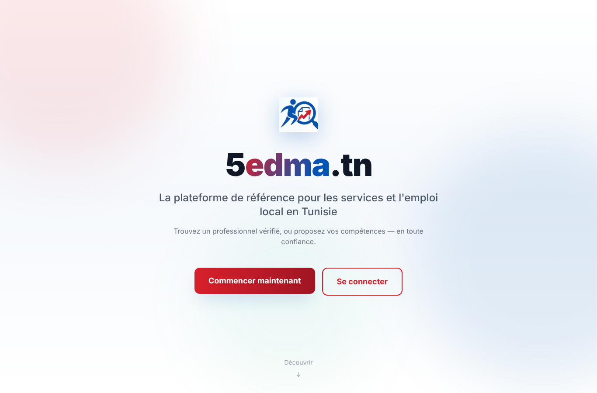
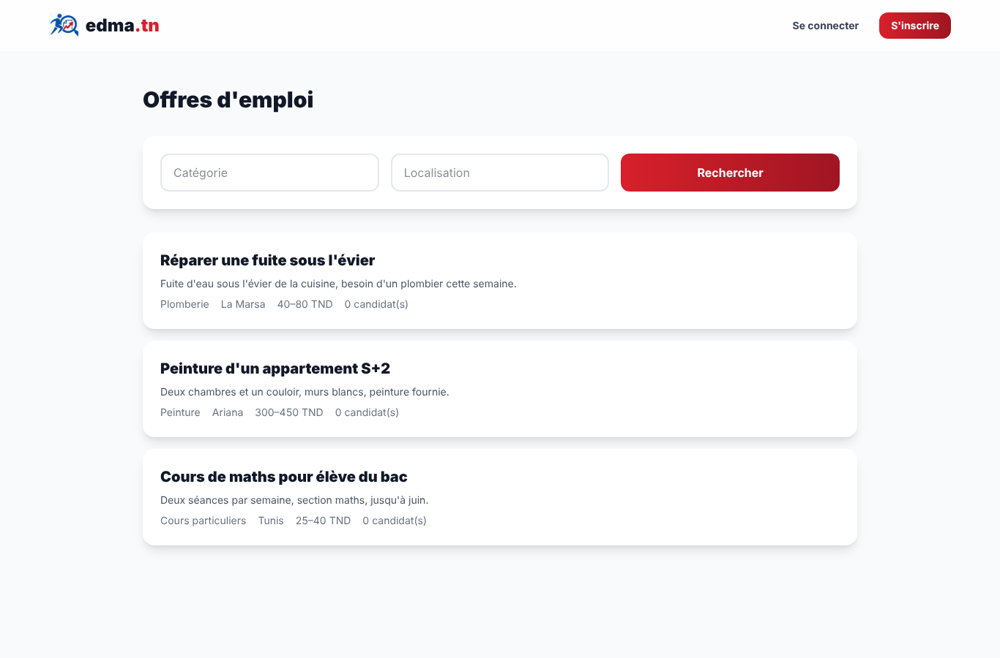
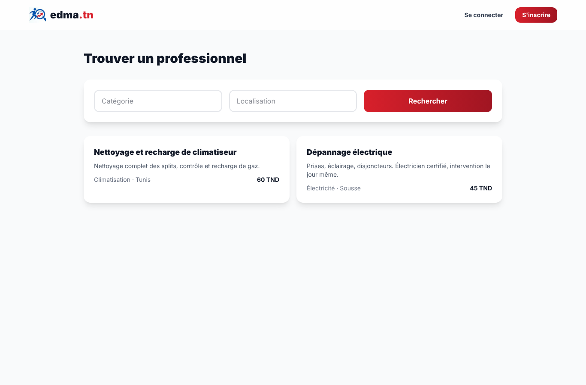

<p align="center">
  
</p>

<h1 align="center">5edma.tn</h1>

<p align="center">
  A Tunisian marketplace for local services and gig work. Clients find verified workers, and workers sell their skills.<br>
  <b>FastAPI · MySQL · Next.js 16 · React 19 · Tailwind v4 · Docker</b>
</p>



## What it does

5edma.tn ("khedma" = *work* in Tunisian Arabic) has three roles: **client**, **worker** and **admin**. Clients and workers can work together in two ways:

| Flow | How it works |
|---|---|
| **Jobs & applications** | A client posts a one-off need with a budget → workers apply → the client accepts one → job completed |
| **Services & bookings** | A worker publishes a fixed-price service (e.g. *AC cleaning, 60 TND*) → a client books it directly → the worker confirms and completes it |

Around those flows:

- **ID verification:** workers and clients upload an ID; an admin approves or rejects it before they can post, apply or book
- **Reviews** on completed jobs and bookings, in both directions
- **Real-time chat** per job: REST history plus a WebSocket authenticated by the same JWT
- **Wallet:** balance and transactions, with top-ups and withdrawals approved by an admin
- **Premium plans and job boosts:** boosted jobs are listed first
- **AI writing help:** generates worker bios and job descriptions with Groq (Llama 3.3 70B), and falls back gracefully when no API key is set
- **Admin dashboard:** verification queue and moderation
- SEO basics: metadata, `sitemap.xml`, `robots.txt`, Open Graph image

| Job offers | Services |
|---|---|
|  |  |

## Architecture

```
frontend/  Next.js App Router (client components), AuthContext + typed fetch wrapper (lib/api.ts)
   │  HTTPS / JSON + WebSocket (JWT)
backend/   FastAPI (async) · SQLAlchemy 2.0 async · Alembic · slowapi rate limiting
   │
MySQL      users, worker/client profiles, job_offers, job_applications, services,
           bookings, reviews, wallets, transactions, messages, subscriptions
```

- ~60 REST endpoints; interactive API docs at `/docs` (turned off in production)
- **Security:** JWT auth with role guards, pbkdf2 password hashing, rate-limited login and registration, security headers (HSTS in production), CORS allow-list, request correlation IDs, and a global error handler that never leaks stack traces
- **Documentation:** [`docs/ARCHITECTURE.md`](docs/ARCHITECTURE.md), UML [use-case](docs/uml/use_case.png), [class](docs/uml/class_diagram.png) and [ERD](docs/uml/erd.png) diagrams, plus a project report and technical guide in French (`docs/*.docx`)

## Quick start

### With Docker (MySQL + backend + frontend)

```bash
cp .env.example .env      # set MYSQL_ROOT_PASSWORD, SECRET_KEY, (optional) GROQ_API_KEY
docker compose up --build
```

Frontend: <http://localhost:3000> · API: <http://localhost:8000> (`/docs` in development).

### Manual setup

```bash
# Backend
cd backend
python -m venv venv && venv\Scripts\activate      # macOS/Linux: source venv/bin/activate
pip install -r requirements.txt
copy .env.example .env                             # DATABASE_URL, SECRET_KEY, GROQ_API_KEY
mysql -u <user> -p <database> < database/schema.sql   # or: alembic upgrade head
python create_admin.py                             # create the first admin account
uvicorn main:app --reload

# Frontend (in a second terminal)
cd frontend
npm install
copy .env.local.example .env.local                 # NEXT_PUBLIC_API_URL, NEXT_PUBLIC_SITE_URL
npm run dev
```

More detail: [`backend/README.md`](backend/README.md) · [`frontend/README.md`](frontend/README.md).

## Tests

```bash
cd backend
pip install -r requirements-dev.txt
pytest           # 18 tests on in-memory SQLite: auth, admin verification, jobs, wallet
```

The suite includes regression tests for two security bugs found during development: self-registering as **admin**, and worker approval that silently did nothing.

## Roadmap

- Online payment gateway (Flouci / D17) instead of admin-approved top-ups
- Audit trail for ID re-submissions
- Shared rate-limit storage (Redis) for multi-instance deployments

## License

[MIT](LICENSE) © 2026 Youssef Hmidi
